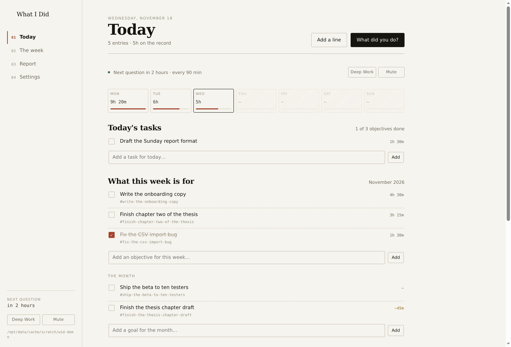
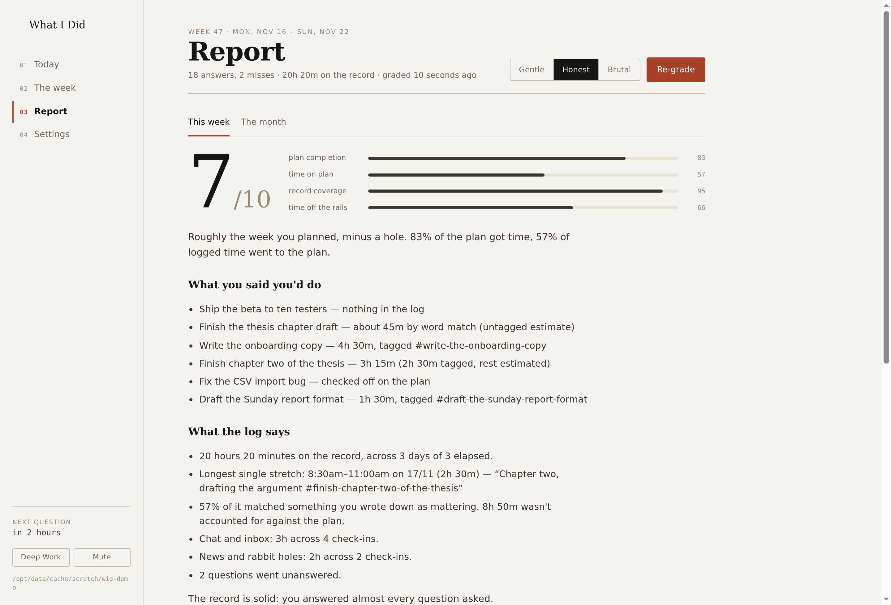

# What I Did

**It interrupts you, asks what you just did, and grades the week against your own goals.**

A free, open-source, local-first alternative to [whatcha-doing.com](https://www.whatcha-doing.com/).
No account, no subscription, no trial. MIT licensed. Your log is a folder of markdown files you
can read, edit, grep and delete without this program.

Works on the same machine you work on: Windows, macOS, Linux. Needs Python 3.10+.




---

## The loop

**Monday, four minutes.** Write what the month is for, two or three objectives for this week, and
today's tasks. This list is the only rubric the app will ever use. It has no opinion of its own
about what counts as productive — if your goal for the week was to rest, and you rested, you get a
good report.

**All week, six seconds each.** A pop-up asks: *what did you do in the last 1h 30m?* You type one
line. It closes. The span is filled in for you and written to a text file. You choose the interval,
from five minutes to eight hours. Ninety is the suggested start.

**Sunday.** The week's log goes up against Monday's plan. You get a score out of 10, what you said
you'd do next to what the log says you did, the one pattern behind the gap, and one instruction for
next week. Set the tone to Gentle, Honest or Brutal — the findings and the score are identical in all
three, only the delivery changes.

**End of the month.** The same thing across every week that has data: what you achieved, how the
weeks compared, the habit that kept costing you, and a plan for next month.

---

## Run it

```bash
git clone https://github.com/Chukwuebuka-2003/whatidid
cd whatidid
python3 -m venv .venv && . .venv/bin/activate
pip install fastapi uvicorn          # the only two dependencies
python -m whatidid                  # opens http://127.0.0.1:8765
```

Or install it as a command:

```bash
pip install -e .
whatidid                 # serve and open the browser
whatidid status          # is a question due, where is the folder
whatidid grade           # write this week's report from the terminal
whatidid grade --week 2026-W47
whatidid export md       # dump everything to stdout
```

Useful flags:

```bash
whatidid --port 9000             # a different port
whatidid --data ~/Sync/whatidid  # a folder of your choosing (Syncthing, iCloud, git…)
whatidid --host 0.0.0.0          # reachable from your phone on the same wifi — read the warning below
python -m whatidid serve --no-open
```

The app is a normal web page served from loopback, so you can "install" it as an app from Chrome or
Safari (Add to Dock / Add to Home Screen) and it gets its own window and icon.

### Keep it running

The clock lives in the server, so keep `whatidid` running while you work.

- **Linux:** a systemd user unit (`ExecStart=/usr/bin/whatidid --data %h/.whatidid`), enabled with
  `systemctl --user enable --now whatidid`.
- **macOS:** a `launchd` agent with `RunAtLoad`.
- **Windows:** a shortcut in `shell:startup` running `pythonw -m whatidid`.

### Why not a native desktop app

Because this is one HTML file and one small Python process, and it runs identically on all three
platforms without a 250 MB Electron bundle. The trade is that it lives in a browser tab unless you
install it as a web app. Everything it does happens on your machine either way.

---

## Where your data lives

```
~/.whatidid/
  2026/
    2026-W47/
      plan.md      what the week is for
      log.md       one line per check-in, grouped by day
      report.md    the Sunday report
    2026-11/
      report.md    the monthly report
  settings.json    interval, hours, tone, grader, key (chmod 600)
```

`2026-W47/log.md`, in full:

```markdown
# Week 47, 2026 (16 Nov – 22 Nov 2026)

## Mon 2026-11-16
- 08:10–09:40 (1h 30m) | Deep work on the onboarding copy, first pass #write-the-onboarding-copy
- 09:40–10:10 (30m) | Scrolling twitter (oops)
- 10:10–11:40 (1h 30m) | Onboarding copy, second pass, sent for review #write-the-onboarding-copy

## Tue 2026-11-17
- 08:30–11:00 (2h 30m) | Chapter two, drafting the argument #finish-chapter-two-of-the-thesis
- 11:30–12:00 (30m) | (no answer)
```

Edit it by hand if you like — the parser is forgiving about `-` versus `–`, `9:05` versus `09:05`,
and a missing `(1h 30m)`, because it recomputes durations from the times. There is no database to
get out of sync with.

Nothing is sent anywhere while you work. The only outbound request this program makes is the one
you ask for, on Sunday, and only if you chose the model grader (see below).

**`--host 0.0.0.0` has no authentication.** It is meant for a phone on your own wifi. Anyone who can
reach that port can read and write your log. Don't expose it to the internet.

---

## How the grading works

Two graders, and the default one needs nothing.

### On this machine (default, free, offline)

A deterministic analyser in `whatidid/graders/analysis.py`. It never calls a model and takes
milliseconds.

- **Plan completion** — how many objectives got any time, weighted: this week's objectives count
  fully, the month's count 0.6, today's tasks 0.8.
- **Time on plan** — of the minutes you logged, how many are against something you wrote down.
- **Record coverage** — half your answer rate (answered vs skipped questions), half the share of
  elapsed days that have any record at all.
- **Time off the rails** — share of logged time the distraction lexicon recognised.

Weighted 35 / 30 / 20 / 15, rounded to a score out of 10. An objective gets **exact** credit when
the check-in carries its hashtag (`#write-the-onboarding-copy`) and **estimated** credit when the
words merely overlap, and the report always says which it used. `~` in the UI means estimate.

An entry with neither gets counted as time that matched nothing on the plan — which is a fact, not
an accusation. Some of it is the real job.

**No plan, no score.** If you never wrote what the week was for, the report says so rather than
inventing a standard. A high score on a thin record comes with a caveat saying it is a ceiling,
not a measurement.

The full rubric, with worked examples, is in [docs/GRADING.md](docs/GRADING.md).

### A model, with your key (optional)

If you want prose that reads a little more like a person, paste a key and the week's log goes
**straight from your machine to the provider you chose**: OpenAI or anything OpenAI-compatible
(DeepSeek, Groq, OpenRouter, LM Studio), Anthropic, Google Gemini, or a local Ollama daemon (no key,
no network, no cost). A report costs a few cents. The prompt is in
`whatidid/graders/prompts.py` — read it before you send a week of your life to a model.

If the call fails, the offline analyser writes the report instead and the UI says so. You never lose
a Sunday report to an API error.

---

## What it does that the paid one doesn't

| | Whatcha Doing | What I Did |
| --- | --- | --- |
| Price | $5/mo, $48/yr or $65 once | free forever, MIT |
| Trial | first week only | none needed |
| Grading without an API key | only on their server | yes, deterministic, offline |
| Log format | plain text, their layout | plain markdown, hand-editable, forgiving parser |
| Move machines | reinstall | copy or sync the folder |
| Read the grader | no | `whatidid/graders/analysis.py` |
| Change the grader | no | fork it, it's 200 lines |
| Suck it into your own tools | no | `whatidid export json`, or just read the files |

---

## Is this going to drive me insane?

Probably, if you set it to every fifteen minutes on day one. Set it to ninety, and turn on **Deep
Work** when you need a long run: it holds the questions and asks once about the whole stretch when
you come back up. You can mute it entirely. Muting changes nothing except whether it asks.

## What if I just lie to it?

Then you've learned something no dashboard could tell you. Nobody lies to a tool they set up to help
them, so if you catch yourself typing something false at 3pm, pay attention to that.

## Keyboard

`n` ask yourself now · `1`–`4` switch views · `d` Deep Work · `Esc` snooze 15 minutes ·
`Enter` save a check-in.

## Tests

```bash
python -m unittest discover -s tests -t .
```

117 tests: markdown parsing (including hand-mangled files), the clock across midnight, weekends and
Deep Work, the rubric on worked weeks (including a week whose plan was to rest), tone invariance, the
HTTP surface, the model grader's failure modes, and the path-traversal guard on the file reader.

## Licence

MIT. Do what you like with it.